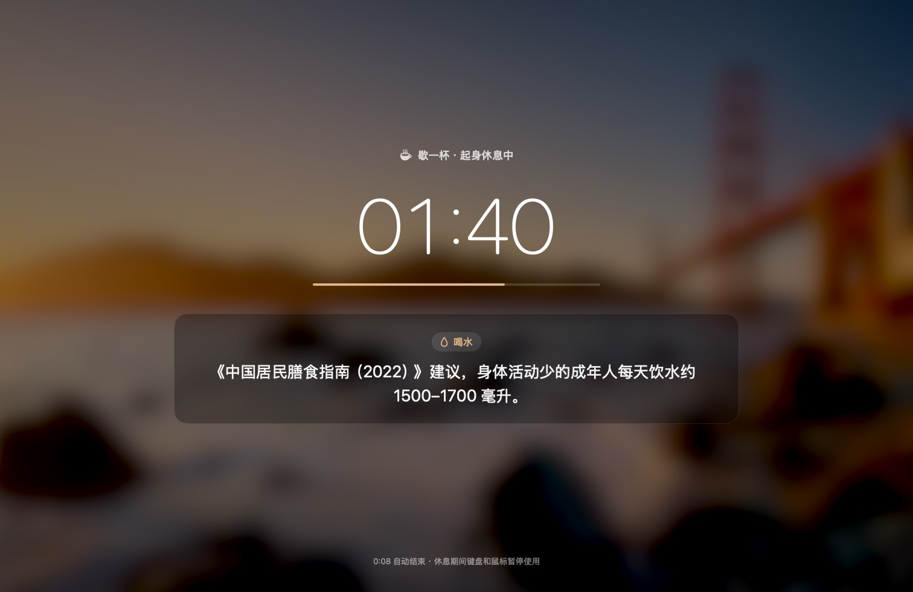
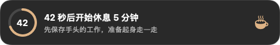
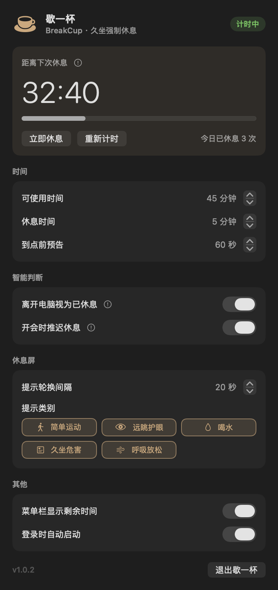

# 歇一杯 BreakCup

停下来，歇一歇。

歇一杯是一个 macOS 菜单栏小工具，用来防久坐，而且是强制的。连续使用电脑到设定时间后，所有屏幕都会被休息屏盖住。休息期间键盘和鼠标都没法让它提前结束，休息时间到了才自动解锁。休息屏上轮播久坐危害、简单运动、喝水、远眺、呼吸放松五类健康提示。



<p align="center">
  
</p>

<p align="center">
  
</p>

## 功能

- **菜单栏咖啡杯**：显示距离休息还剩几分钟。点开是设置面板，可以调可使用时间、休息时间、预告时长、提示轮换间隔和提示类别。面板上的说明文字都收在感叹号里，鼠标指上去 0.25 秒就会显示；登录项需要处理时，感叹号变成橙色。
- **到点前预告**：默认提前 60 秒在每块屏顶部出现倒计时条，不抢焦点、不挡点击，也不能推迟。
- **强制休息**：每块屏一扇全屏休息屏。⌘Tab、⌘Q、强制退出、程序坞和菜单栏都被禁用，休息结束后焦点交还给原来的应用。
- **多屏幕**：每块屏都有自己的休息屏和预告条，排版按屏幕尺寸自适应；休息中插拔显示器会自动重建。
- **开会不打扰**：到点时麦克风或摄像头正在使用，就先不休息，等会议结束再预告。远程桌面和录屏不算开会。
- **离开过就不罚**：离开电脑、锁屏或睡眠的时间够一个休息时长，就算已经休息过，重新计时。
- **不要任何权限**：不申请麦克风、摄像头、录屏、辅助功能权限，只读取设备是否被占用。

## 安装

要求 macOS 14 及以上，以及 Swift 5.10 及以上的工具链。装了 Xcode 或者只装 Command Line Tools（`xcode-select --install`）都可以。

```bash
git clone https://github.com/lawzhang1983/BreakCup.git
```

```bash
cd BreakCup && ./scripts/build-app.sh --install
```

这条命令依次完成编译、生成咖啡杯图标、组装并签名 `歇一杯.app`，再安装到 `/Applications` 并启动。启动后菜单栏会出现咖啡杯图标，点击图标打开设置面板。想开机自动运行，在面板「其他」里打开「登录时自动启动」。

只构建、不安装：

```bash
./scripts/build-app.sh
```

产物在 `dist/歇一杯.app`。

应用是本机 ad-hoc 签名，在哪台电脑上用，就在哪台上构建。

## 卸载

先在面板里关掉「登录时自动启动」，再执行：

```bash
pkill -x BreakCup; rm -rf "/Applications/歇一杯.app"; defaults delete com.lawzhang.breakcup
```

## 它怎么工作

| 阶段 | 触发条件 | 屏幕上发生什么 |
|---|---|---|
| 计时中 | 启动、休息结束或被判定为已休息后 | 菜单栏显示剩余分钟 |
| 预告 | 距离休息还剩「到点前预告」秒数 | 每块屏顶部出现倒计时条，不能推迟 |
| 会议推迟 | 到点时麦克风或摄像头正在使用 | 不启动休息；两者连续空闲 5 秒后重新预告 |
| 强制休息 | 预告结束 | 每块屏一扇全屏休息屏，kiosk 模式吞掉全部键鼠输入 |

默认参数：可使用 45 分钟，休息 5 分钟，预告 60 秒，提示每 20 秒换一条。

**怎么判断在开会**：

- 按进程查谁在采集音频，只放音乐不算开会。
- 系统录屏服务 `replayd` 采集的声音也不算，它属于远程桌面和录屏。像 UU 远程这类远程桌面，会通过 ScreenCaptureKit 把本机声音传给控制端，期间 `replayd` 一直处于采集状态，但它并没有占用麦克风。
- 真正开会时，会议软件自己的进程会采集麦克风，所以开着远程桌面开会，照样会推迟。
- 摄像头只要有任何应用在用，就算开会。

**计时什么时候清零**：

- 键鼠闲置达到 `max(休息时长, 5 分钟)` 时，视为你离开过电脑，重新计时。开会期间闲置不算离开；远程桌面注入的键鼠也算在用电脑。
- 锁屏或系统睡眠持续一个休息时长以上，也算休息过。
- 设置面板里的「重新计时」按钮可以手动清零。

**休息期间拦住了什么**：

- ⌘Tab 切换应用、⌥⌘Esc 强制退出、隐藏应用、苹果菜单、关机注销对话框、程序坞和菜单栏都被禁用。
- 应用内的所有按键、点击和滚轮都会被丢弃，⌘Q 也会被拒绝。
- 休息期间保持亮屏，并且定期声明用户活动，防止系统屏保或锁屏盖住休息屏。

## 为什么不用系统屏保

最初的设想是直接调用 macOS 系统屏保，在 macOS 27 上做了探针实测后放弃了：

- 系统屏保由 loginwindow 放在锁屏层里运行，窗口层级 2001–2004，所在空间位于所有应用之上。第三方窗口哪怕开到系统允许的最高层级 2147483628，也只能排在它后面，所以提示文字没法叠在系统屏保上。
- 屏保被键鼠唤醒是 loginwindow 自己监听的，应用层拦不住。

所以改为全程自绘休息屏。背景是当前桌面壁纸的模糊图，用 Core Animation 做 40 秒一个来回的缓慢推拉。航拍、动态这类没有图片文件的壁纸，系统返回的是默认航拍静帧。

## 已知边界

- **没有紧急出口**：这是有意的设计，休息一旦开始只能等它结束。休息时长上限 60 分钟，保证一定有尽头。真遇到卡死，可以从另一台设备 SSH 登录后执行 `pkill -x BreakCup`，进程一退出，休息屏就随之消失。
- **只在休息开始前检查会议**：休息进行中如果有来电或会议开始，不会中途解除。
- **不碰键鼠看视频会被当成离开**：连续 5 分钟以上没有键鼠输入，就会被判定为离开过电脑，计时清零。
- **系统级快捷键拦不全**：Spotlight、截图这类由系统进程处理的快捷键拦不住。即使打开了别的应用，它的窗口也只能待在休息屏下面，歇一杯会每秒把自己拉回前台。

## 开发

只装 Command Line Tools、没有完整 Xcode 时有三个限制，代码和脚本都已经绕开：

- 新版 SwiftPM 默认的 swift-build 构建系统会初始化失败，所以统一加 `--build-system native`。
- `swift test` 只编译测试、不执行，所以测试编成可执行目标，用 `swift run` 运行。
- SwiftUI 的 `@State` 在 macOS 27 SDK 里是宏，宏插件只随 Xcode 提供，因此代码里不用 `@State`，视图状态放在 `ObservableObject` 里。

运行测试：

```bash
swift run --build-system native BreakCupCoreTests
```

编译：

```bash
swift build --build-system native
```

界面验收：把休息屏、预告条和设置面板离屏渲染成 PNG，不需要录屏权限；同时在终端打印每个感叹号的悬停说明和位置。

```bash
"dist/歇一杯.app/Contents/MacOS/BreakCup" --snapshot /tmp/breakcup-snapshots
```

实测时可以临时把时长调成小数分钟（设置面板的下限更高，`defaults` 可以绕开），测完删掉这些键即可恢复默认：

```bash
defaults write com.lawzhang.breakcup workMinutes -float 0.75
```

```bash
defaults write com.lawzhang.breakcup warningSeconds -float 15
```

```bash
defaults write com.lawzhang.breakcup restMinutes -float 0.4
```

从终端直接运行 `dist/歇一杯.app/Contents/MacOS/BreakCup`，可以在标准输出看到阶段切换、设备占用变化和休息屏巡检日志。

## 目录

| 路径 | 内容 |
|---|---|
| `Sources/BreakCupCore/` | 纯逻辑：设置、调度状态机、健康提示库、开会判定，不依赖界面，可单测 |
| `Sources/BreakCup/` | 菜单栏、设置面板、预告条、休息屏、麦克风和摄像头检测、空闲与锁屏检测 |
| `Tests/BreakCupCoreTests/` | 26 个 swift-testing 用例，覆盖调度、设置存取、提示轮换、格式化、开会判定 |
| `Resources/Info.plist` | 应用元数据：`LSUIElement` 菜单栏应用，Bundle ID 为 `com.lawzhang.breakcup` |
| `scripts/build-app.sh` | 构建、组装、签名、安装 |
| `scripts/generate-icon.swift` | 用 SF Symbols 生成拿铁色咖啡杯应用图标 |
| `docs/images/` | README 用的界面截图，由 `--snapshot` 离屏渲染 |

## 健康提示的出处

带数字的说法只保留有公开出处的：

- 20-20-20 用眼法则（美国眼科学会）。
- WHO 2020《身体活动和久坐行为指南》。
- 《中国居民膳食指南（2022）》。
