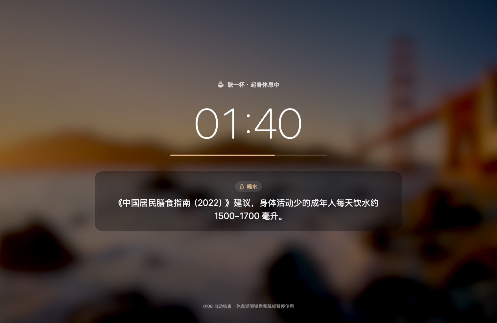
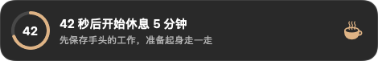
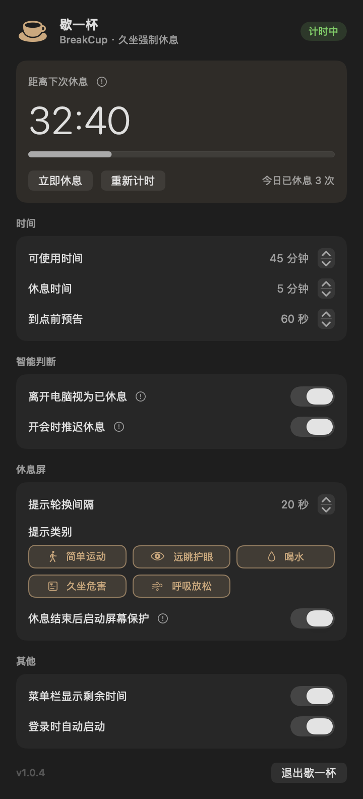

# 歇一杯 BreakCup

停下来，歇一歇。

歇一杯是一个防久坐的小工具，而且是强制的，macOS 上住在菜单栏，Windows 上住在系统托盘。连续使用电脑到设定时间后，所有屏幕都会被休息屏盖住。休息期间键盘和鼠标都没法让它提前结束，休息时间到了才自动解锁。休息屏上轮播久坐危害、简单运动、喝水、远眺、呼吸放松五类健康提示。



<p align="center">
  
</p>

<p align="center">
  
</p>

## 功能

- **菜单栏咖啡杯**：显示距离休息还剩几分钟，嫌分心可以在面板「其他」里关掉，只留咖啡杯。点开是设置面板，可以调可使用时间、休息时间、预告时长、提示轮换间隔和提示类别。面板上的说明文字都收在感叹号里，鼠标指上去 0.25 秒就会显示；登录项需要处理时，感叹号变成橙色。
- **到点前预告**：默认提前 60 秒在每块屏顶部出现倒计时条，不抢焦点、不挡点击，也不能推迟。
- **强制休息**：每块屏一扇全屏休息屏。⌘Tab、⌘Q、强制退出、程序坞和菜单栏都被禁用，休息结束后焦点交还给原来的应用。
- **休息完接屏保**：休息时人可能走开了，休息屏收起后接着启动系统屏幕保护（Windows 没配屏保时直接锁屏），屏幕不会一直亮着内容。唤醒时要不要输密码由系统设置决定，面板「休息屏」里的感叹号会显示当前设置；一直坐在电脑前嫌打扰，可以在那里关掉。
- **多屏幕**：每块屏都有自己的休息屏和预告条，排版按屏幕尺寸自适应；休息中插拔显示器会自动重建。
- **开会不打扰**：到点时麦克风或摄像头正在使用，就先不休息，等会议结束再预告。远程桌面和录屏不算开会。
- **离开过就不罚**：离开电脑、锁屏或睡眠的时间够一个休息时长，就算已经休息过，重新计时。
- **不要任何权限**：不申请麦克风、摄像头、录屏、辅助功能权限，只读取设备是否被占用。

## 安装

### macOS

要求 macOS 14 及以上，以及 Swift 5.10 及以上的工具链。装了 Xcode 或者只装 Command Line Tools（`xcode-select --install`）都可以。

```bash
git clone https://github.com/lawzhang1983/BreakCup.git
```

```bash
cd BreakCup && ./scripts/build-app.sh --install
```

这条命令依次完成编译、生成咖啡杯图标、组装并签名 `歇一杯.app`，再安装到 `/Applications` 并启动。启动后菜单栏会出现咖啡杯图标，点击图标打开设置面板。想开机自动运行，在面板「其他」里打开「登录时自动启动」。

只构建、不安装：

```bash
./scripts/build-app.sh
```

产物在 `dist/歇一杯.app`。

应用是本机 ad-hoc 签名，在哪台电脑上用，就在哪台上构建。

### Windows

要求 Windows 10 1903 及以上或 Windows 11（系统自带 .NET Framework 4.8，不用另装运行库）。构建需要 [.NET SDK](https://dotnet.microsoft.com/download) 8 或更新版本。在仓库根目录的 PowerShell 里执行：

```powershell
powershell -ExecutionPolicy Bypass -File windows\scripts\build.ps1 -Install
```

这条命令依次跑核心单测、编译，再安装到 `%LOCALAPPDATA%\Programs\BreakCup`、在开始菜单建「歇一杯」快捷方式并启动。启动后托盘里出现咖啡杯图标，左键或右键点它都会弹出设置面板，面板的内容和 Mac 版一样。Windows 11 会把新图标收进任务栏的「^」里，拖到任务栏上就能常驻。想开机自动运行，在面板「其他」里打开「登录时自动启动」。

不加 `-Install` 只构建，产物在 `windows\dist\BreakCup`，整个文件夹可以拷到别的电脑直接运行。

## 卸载

macOS：先在面板里关掉「登录时自动启动」，再执行：

```bash
pkill -x BreakCup; rm -rf "/Applications/歇一杯.app"; defaults delete com.lawzhang.breakcup
```

Windows：先在面板里关掉「登录时自动启动」并点「退出歇一杯」，再在 PowerShell 里执行：

```powershell
Remove-Item -Recurse "$env:LOCALAPPDATA\Programs\BreakCup", "$env:LOCALAPPDATA\BreakCup", "HKCU:\Software\BreakCup"; Remove-Item "$([Environment]::GetFolderPath('Programs'))\歇一杯.lnk"
```

## 它怎么工作

| 阶段 | 触发条件 | 屏幕上发生什么 |
|---|---|---|
| 计时中 | 启动、休息结束或被判定为已休息后 | 菜单栏显示剩余分钟 |
| 预告 | 距离休息还剩「到点前预告」秒数 | 每块屏顶部出现倒计时条，不能推迟 |
| 会议推迟 | 到点时麦克风或摄像头正在使用 | 不启动休息；两者连续空闲 5 秒后重新预告 |
| 强制休息 | 预告结束 | 每块屏一扇全屏休息屏，kiosk 模式吞掉全部键鼠输入 |
| 休息结束 | 休息时间到 | 显示「休息结束，欢迎回来」，淡出解锁，接着启动系统屏保（可关） |

默认参数：可使用 45 分钟，休息 5 分钟，预告 60 秒，提示每 20 秒换一条。

**怎么判断在开会**：

- 按进程查谁在采集音频，只放音乐不算开会。
- 系统录屏服务 `replayd` 采集的声音也不算，它属于远程桌面和录屏。像 UU 远程这类远程桌面，会通过 ScreenCaptureKit 把本机声音传给控制端，期间 `replayd` 一直处于采集状态，但它并没有占用麦克风。
- 真正开会时，会议软件自己的进程会采集麦克风，所以开着远程桌面开会，照样会推迟。
- 摄像头只要有任何应用在用，就算开会。

**计时什么时候清零**：

- 键鼠闲置达到 `max(休息时长, 5 分钟)` 时，视为你离开过电脑，重新计时。开会期间闲置不算离开；远程桌面注入的键鼠也算在用电脑。
- 锁屏或系统睡眠持续一个休息时长以上，也算休息过。
- 休息结束后的屏保或锁屏期间人一直没回来，同样按上面两条重新计时。这只会把下次休息往后推，不会再触发一次休息，也不影响刚结束的这次。
- 设置面板里的「重新计时」按钮可以手动清零。

**休息期间拦住了什么**：

- ⌘Tab 切换应用、⌥⌘Esc 强制退出、隐藏应用、苹果菜单、关机注销对话框、程序坞和菜单栏都被禁用。
- 应用内的所有按键、点击和滚轮都会被丢弃，⌘Q 也会被拒绝。
- 休息期间保持亮屏，并且定期声明用户活动，防止系统屏保或锁屏盖住休息屏。

**休息结束后的屏幕保护**：

- 休息屏淡出、亮屏断言释放、焦点交还原来的应用之后，打开 `/System/Library/CoreServices/ScreenSaverEngine.app` 启动系统屏保，和闲置到点时启动的是同一个。
- 唤醒时要不要输密码，看「系统设置 › 锁定屏幕」里的「屏幕保护程序启动或显示器关闭后需要密码」。歇一杯只读不改：每次打开面板和启动屏保时用 `sysadminctl -screenLock status` 读一次，结果显示在开关的感叹号里，也写进日志。比如设成「15 分钟后」，那 15 分钟内动一下键鼠就能直接回到桌面；想让别人碰不到，把它改成「立即」。
- 默认打开，没有按「人在不在」自动跳过：休息期间歇一杯自己每 30 秒声明一次用户活动，系统的空闲计时被它刷新过，分不出人是不是走开了。所以做成开关，人一直坐着嫌打扰就关掉。

## Windows 版的不同之处

界面、参数、调度规则和 Mac 版一致，核心逻辑逐行移植，单测也是 29 个，只有开会判定和屏保设置解读这几条按平台各写各的。和系统打交道的部分换成了 Windows 的做法：

- **托盘图标**：托盘里放不下「咖啡杯加文字」，显示剩余时间时换成一块拿铁色小方块，里面是剩余分钟数，最后一分钟变橙色、显示秒数。关掉「托盘图标显示剩余时间」就只剩咖啡杯，按任务栏深浅画白色或黑色，预告和休息中换成实心杯。鼠标悬停能看到完整说明。
- **怎么判断在开会**：读系统「隐私和安全性」里记录的麦克风、摄像头使用状态，哪个应用正在用就算开会。只放音乐不占用麦克风，不算开会。
- **休息期间拦住了什么**：低级键盘钩子吞掉全部按键，包括 ⊞ 键、Alt+Tab、Alt+F4、Ctrl+Shift+Esc；低级鼠标钩子吞掉点击和滚轮，只放行移动，鼠标指针也隐藏。休息窗口每秒巡检一次，保持置顶和前台。钩子装在独立线程上，界面卡顿时系统也不会把它摘掉；过了休息结束时间 15 秒钩子自动放行，作为兜底。
- **拦不住的**：Ctrl+Alt+Del 和 ⊞+L 由系统安全桌面处理，任何程序都拦不住。锁屏不影响休息倒计时；从 Ctrl+Alt+Del 打开的任务管理器以管理员权限运行，键鼠钩子管不到它，有机会结束歇一杯，这是 Windows 上封不死的出口。
- **不熄屏**：休息期间阻止熄屏，并每 30 秒刷新一次系统空闲计时，屏保和自动锁屏不会盖住休息屏。休息中注销或关机会被拦下，系统会提示「歇一杯正在阻止关机」，仍然可以强制继续。
- **休息结束后的屏保**：先读 `HKCU\Control Panel\Desktop`（组策略里的同名值优先）的 `SCRNSAVE.EXE`、`ScreenSaveActive`、`ScreenSaverIsSecure`。配了屏保，就向自己的隐藏窗口发 `WM_SYSCOMMAND` / `SC_SCREENSAVE`，交给 `DefWindowProc`，系统按用户的设置启动屏保，和闲置到点时一样；唤醒要不要密码看屏幕保护程序设置里的「在恢复时显示登录屏幕」。
- **没配屏保就锁屏**：在设置里选「无」只会删掉 `SCRNSAVE.EXE`，`ScreenSaveActive` 往往还是 1，这时 `SC_SCREENSAVE` 没有任何反应（已实测）。退路定为直接锁屏（`LockWorkStation`），不只是关显示器：关显示器时路过的人动一下鼠标就能看到内容，锁屏才符合「人走开了不能亮着内容」的目标，代价是回来要输密码或 PIN。配了屏保、3 秒后却没起来，而且期间没人碰过键鼠，也改为锁屏。想要「动一下鼠标就回桌面」，就在系统里配一个屏保并取消勾选「在恢复时显示登录屏幕」。
- **多屏幕**：每块屏各一扇休息窗口和一条预告条，按各自的缩放比例排版，已在四块屏（两块 3840×2160、两块 2560×1440）上实测。
- **设置和日志**：设置存在注册表 `HKCU\Software\BreakCup`，键名和 Mac 版一致；运行日志在 `%LOCALAPPDATA%\BreakCup\breakcup.log`。
- **图标**：SF Symbols 只许在苹果平台上用，Windows 版的图标换成了微软的 [Fluent UI System Icons](https://github.com/microsoft/fluentui-system-icons)（MIT），见 [windows/THIRD-PARTY-NOTICES.md](windows/THIRD-PARTY-NOTICES.md)。

## 为什么不用系统屏保

最初的设想是直接调用 macOS 系统屏保，在 macOS 27 上做了探针实测后放弃了：

- 系统屏保由 loginwindow 放在锁屏层里运行，窗口层级 2001–2004，所在空间位于所有应用之上。第三方窗口哪怕开到系统允许的最高层级 2147483628，也只能排在它后面，所以提示文字没法叠在系统屏保上。
- 屏保被键鼠唤醒是 loginwindow 自己监听的，应用层拦不住。

所以改为全程自绘休息屏。背景是当前桌面壁纸的模糊图，用 Core Animation 做 40 秒一个来回的缓慢推拉。航拍、动态这类没有图片文件的壁纸，系统返回的是默认航拍静帧。

休息结束后再启动系统屏保不受这两点影响：那时休息屏已经收起，屏保盖在最上层、被键鼠唤醒，正是想要的效果。

## 已知边界

- **没有紧急出口**：这是有意的设计，休息一旦开始只能等它结束。休息时长上限 60 分钟，保证一定有尽头。真遇到卡死，可以从另一台设备 SSH 登录后执行 `pkill -x BreakCup`，进程一退出，休息屏就随之消失。
- **只在休息开始前检查会议**：休息进行中如果有来电或会议开始，不会中途解除。
- **不碰键鼠看视频会被当成离开**：连续 5 分钟以上没有键鼠输入，就会被判定为离开过电脑，计时清零。
- **人在也会弹屏保**：分不出休息时人有没有走开，所以休息结束一律启动屏保（Windows 没配屏保时是锁屏），坐着的话动一下鼠标就能退出，要密码的话还得解锁。嫌打扰就在面板「休息屏」里关掉。
- **系统级快捷键拦不全**：Spotlight、截图这类由系统进程处理的快捷键拦不住。即使打开了别的应用，它的窗口也只能待在休息屏下面，歇一杯会每秒把自己拉回前台。

## 开发

只装 Command Line Tools、没有完整 Xcode 时有三个限制，代码和脚本都已经绕开：

- 新版 SwiftPM 默认的 swift-build 构建系统会初始化失败，所以统一加 `--build-system native`。
- `swift test` 只编译测试、不执行，所以测试编成可执行目标，用 `swift run` 运行。
- SwiftUI 的 `@State` 在 macOS 27 SDK 里是宏，宏插件只随 Xcode 提供，因此代码里不用 `@State`，视图状态放在 `ObservableObject` 里。

运行测试：

```bash
swift run --build-system native BreakCupCoreTests
```

编译：

```bash
swift build --build-system native
```

界面验收：把休息屏、预告条和设置面板离屏渲染成 PNG，不需要录屏权限；同时在终端打印每个感叹号的悬停说明和位置。

```bash
"dist/歇一杯.app/Contents/MacOS/BreakCup" --snapshot /tmp/breakcup-snapshots
```

实测时可以临时把时长调成小数分钟（设置面板的下限更高，`defaults` 可以绕开），测完删掉这些键即可恢复默认：

```bash
defaults write com.lawzhang.breakcup workMinutes -float 0.75
```

```bash
defaults write com.lawzhang.breakcup warningSeconds -float 15
```

```bash
defaults write com.lawzhang.breakcup restMinutes -float 0.4
```

从终端直接运行 `dist/歇一杯.app/Contents/MacOS/BreakCup`，可以在标准输出看到阶段切换、设备占用变化和休息屏巡检日志。休息结束后日志会写出当前的锁屏密码设置，`pgrep -x ScreenSaverEngine` 能看到屏保进程。

Windows 版在 `windows\` 下，用 .NET SDK 构建，目标框架 .NET Framework 4.8，界面是不带 XAML 的 WPF：

```powershell
dotnet run --project windows\tests\BreakCup.Tests -c Release
```

```powershell
windows\src\BreakCup\bin\Release\net48\BreakCup.exe --snapshot $env:TEMP\breakcup-snapshots
```

实测时同样可以把时长写成小数分钟，测完删掉这几个值即可恢复默认：

```powershell
Set-ItemProperty HKCU:\Software\BreakCup workMinutes 1; Set-ItemProperty HKCU:\Software\BreakCup warningSeconds 20; Set-ItemProperty HKCU:\Software\BreakCup restMinutes 0.5
```

## 目录

| 路径 | 内容 |
|---|---|
| `Sources/BreakCupCore/` | 纯逻辑：设置、调度状态机、健康提示库、开会判定，不依赖界面，可单测 |
| `Sources/BreakCup/` | 菜单栏、设置面板、预告条、休息屏、休息后启动屏保、麦克风和摄像头检测、空闲与锁屏检测 |
| `Tests/BreakCupCoreTests/` | 29 个 swift-testing 用例，覆盖调度、设置存取、提示轮换、格式化、开会判定、锁屏密码设置解读 |
| `Resources/Info.plist` | 应用元数据：`LSUIElement` 菜单栏应用，Bundle ID 为 `com.lawzhang.breakcup` |
| `scripts/build-app.sh` | 构建、组装、签名、安装 |
| `scripts/generate-icon.swift` | 用 SF Symbols 生成拿铁色咖啡杯应用图标 |
| `docs/images/` | README 用的界面截图，由 `--snapshot` 离屏渲染 |
| `windows/src/BreakCup/Core/` | Windows 版纯逻辑，与 `BreakCupCore` 逐行对应 |
| `windows/src/BreakCup/Platform/` | 开会、空闲、锁屏检测，开机启动，休息期间的键鼠拦截与防熄屏，休息后启动屏保或锁屏，壁纸读取 |
| `windows/src/BreakCup/UI/` | 托盘图标、设置面板、预告条、休息屏 |
| `windows/tests/BreakCup.Tests/` | 核心逻辑的 29 个用例，`dotnet run` 执行 |
| `windows/scripts/build.ps1` | 测试、构建、安装 |

## 健康提示的出处

带数字的说法只保留有公开出处的：

- 20-20-20 用眼法则（美国眼科学会）。
- WHO 2020《身体活动和久坐行为指南》。
- 《中国居民膳食指南（2022）》。

## 许可证

[MIT](LICENSE)：可以自由使用、修改、分发，包括商用，只需在副本里保留版权和许可声明。软件按原样提供，不附带任何担保。
